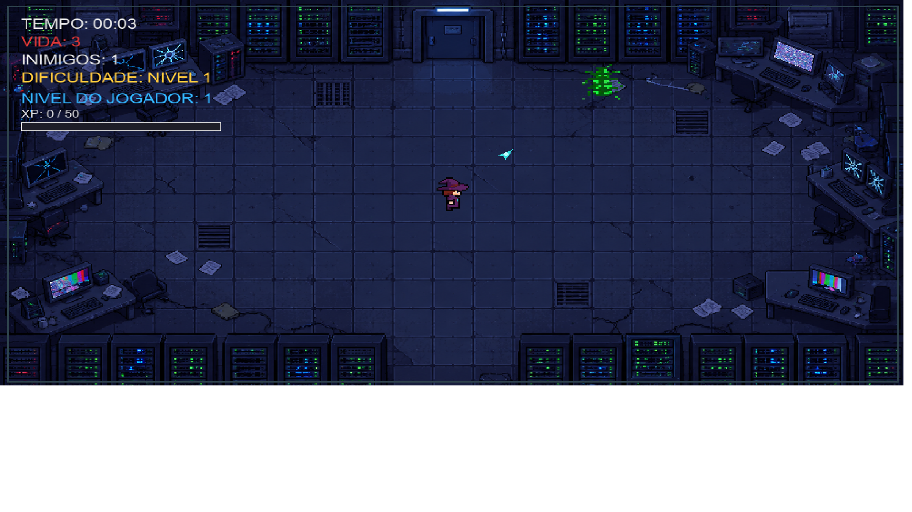

# Exterminador de bugs


<!-- Imagem de apresentação do jogo -->
<p align="center">
  
</p>

## Sobre o projeto

**Exterminador de bugs** é um jogo 2D de sobrevivência desenvolvido em Python utilizando Pygame. Inspirado no gênero *Survivors-like*, o jogador controla um mago que precisa enfrentar hordas de bugs, sobreviver pelo maior tempo possível e evoluir suas habilidades durante a partida.

O projeto também explora conceitos fundamentais de Computação Gráfica, como transformações geométricas, matrizes, animações e detecção de colisões implementada manualmente.


## Controles

| Tecla | Ação |
|---|---|
| `W` | Mover para cima |
| `A` | Mover para a esquerda |
| `S` | Mover para baixo |
| `D` | Mover para a direita |

Os ataques são realizados automaticamente pelo personagem.

## Conceitos de Computação Gráfica

| Conceito | Aplicação no projeto |
|---|---|
| Translação | Movimentação de jogadores, inimigos e projéteis. |
| Rotação | Orientação dos projéteis e movimento das armas orbitais. |
| Escala | Redimensionamento dos elementos gráficos. |
| Matrizes de transformação | Composição e aplicação de transformações geométricas. |
| Delta Time | Controle de movimentação e animações independente da taxa de FPS. |
| Detecção de colisão | Colisão circular implementada manualmente. |
| Animação | Alternância de sprites conforme o movimento do personagem. |

## Estrutura do projeto

```text
SurvivorArena/
│
├── main.py
├── jogo.py
│
├── entidades/
│   ├── jogador.py
│   ├── inimigo.py
│   └── projetil.py
│
├── sistemas/
│   ├── animacao.py
│   ├── armas.py
│   ├── colisoes.py
│   ├── transformacoes.py
│   ├── gerenciador_inimigos.py
│   └── gerenciador_combate.py
│
├── interface/
│   ├── tela.py
│   └── hud.py
│
└── assets/
    ├── exemplo.png
    ├── fundoprincipal.png
    ├── inimigo.png
    ├── east/
    └── west/
```

### Organização

- **entidades/** — classes que representam os elementos do jogo.
- **sistemas/** — lógica de animação, armas, colisões, transformações e gerenciamento.
- **interface/** — elementos visuais da interface e renderização.
- **assets/** — imagens e recursos gráficos utilizados no jogo.

## Como executar

### 1. Clone o repositório

```bash
git clone https://github.com/gabryeltomaz/SurvivorArena.git
```

### 2. Entre na pasta do projeto

```bash
cd SurvivorArena
```

### 3. Instale as dependências

```bash
pip install pygame
```

### 4. Execute o jogo

```bash
python main.py
```

## Objetivo acadêmico

Este projeto foi desenvolvido como parte dos estudos da disciplina de **Computação Gráfica**, com o objetivo de aplicar conceitos teóricos em uma aplicação interativa.

O desenvolvimento busca explorar a implementação manual de operações geométricas e algoritmos de colisão, evitando depender de funcionalidades prontas para essas operações.

---

## Desenvolvedor

Desenvolvido por [gabryeltomaz](https://github.com/gabryeltomaz).
